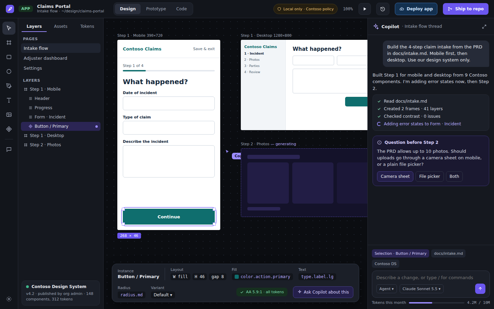

# CADE — Copilot ADE

[](https://github.com/a11smiles/cade/actions/workflows/ci.yml)

CADE is a local, cross-platform desktop workbench for GitHub Copilot-assisted
design work. Its project types cover apps, images, decks, documents, motion,
diagrams, Azure architecture and data models. Projects and the workbench run
locally; Copilot and other configured model requests use their respective
services.

> **Status: early development / pre-alpha.** The repository contains an evolving
> desktop scaffold and working pieces of the underlying crates, not a finished
> or production-ready design product. The project is versioned `0.1.0`. CI
> checks the crates, UI and desktop app on supported platforms, but does not
> publish installers. There are currently no prebuilt downloads.

## Design references

These screenshots were rendered from the latest design export,
[`v0001-2026-10-25`](design/exports/v0001-2026-10-25/README.md). Click either
image to open the exact design-canvas source file.

[](design/exports/v0001-2026-10-25/Main.dc.html)

[](design/exports/v0001-2026-10-25/Main.light.dc.html)

## Install

CADE installers are not currently available for macOS, Windows, or Linux.
The release inventory checked on October 26, 2026 returned no releases. Check
[GitHub Releases](https://github.com/a11smiles/cade/releases) for future
availability, not an existing installer. The configured package targets are:

| Platform | Package formats | Packaging guidance |
|---|---|---|
| macOS | `.dmg`, `.app` | [Tauri macOS bundles](https://v2.tauri.app/distribute/macos-application-bundle/) |
| Windows | `.msi`, NSIS installer | [Tauri Windows installers](https://v2.tauri.app/distribute/windows-installer/) |
| Linux | `.deb`, `.rpm`, `.AppImage` | [Tauri Debian packaging](https://v2.tauri.app/distribute/debian/), [RPM packaging](https://v2.tauri.app/distribute/rpm/), [AppImage packaging](https://v2.tauri.app/distribute/appimage/) |

These are configured build targets, not available downloads. See
[`tauri.conf.json`](app/src-tauri/tauri.conf.json) for the project's target
configuration.

Framework packaging guidance and source builds are not CADE installers.
The per-platform package-link criterion in
[#342](https://github.com/a11smiles/cade/issues/342) remains blocked on actual
package availability.

## Build from source

Use a checkout of this repository. The project pins Rust in
[`rust-toolchain.toml`](rust-toolchain.toml); the UI uses Node.js 22 and pnpm
12.15.0. Install the relevant [Tauri platform prerequisites](https://v2.tauri.app/start/prerequisites/)
first. On Linux, CADE's CI installs `libwebkit2gtk-4.1-dev`,
`libayatana-appindicator3-dev`, `librsvg2-dev`, `libsecret-1-dev` and
`libfontconfig1-dev`.

From the repository root, build the UI and desktop app:

```sh
pnpm --dir app/ui install --frozen-lockfile
pnpm --dir app/ui build
cargo build -p cade-app
```

These are the UI and app build steps used by the cross-platform CI workflow.
They build the source application; they do not publish installers.

## Project contents

| Path | What |
|---|---|
| `crates/` | 19 Rust crates for the document model, CRDT, rendering, Copilot, policy, GitHub integration, importers, exporters and generators |
| `app/src-tauri/` | Tauri 2 desktop shell (`cade-app`) and IPC commands |
| `app/ui/` | React + TypeScript desktop UI |
| `design/system/` | CADE design tokens (dark and light) and brand book; `tokens.json` is the source for `tokens.css` |
| `design/exports/` | Versioned UI design-canvas exports; old exports are kept unchanged |
| `assets/icons/azure/` | Location for Microsoft's Azure Architecture Icons; icon assets are not included |
| `docs/` | Architecture overview and decision records |

## Output types

The project model defines eight output types. The export crate also declares
the formats associated with each type; these declarations describe the planned
export menu, not a claim that all end-to-end exporters are complete.

| Output type | Declared formats |
|---|---|
| App, image | PNG, SVG, PDF |
| Deck | PPTX, PDF, PNG |
| Document | PDF, DOCX, Markdown |
| Motion | MP4, GIF, Lottie, CSS |
| Diagram | VSDX, SVG, PDF, PNG, Mermaid |
| Azure architecture | Bicep, Terraform, SVG, PNG |
| Data model | SQL, SVG, PNG |

## Implemented starting points

These are existing crate capabilities, not a statement that the complete CADE
application is finished. Most are still part of a broader, unfinished product.

| Crate | Existing code |
|---|---|
| `cade-core` | Output kinds, nodes, token-bound values and hex colors |
| `cade-crdt` | Loro project document, movable layer tree, snapshot save/open, merge and JSON mirror |
| `cade-policy` | `policy.yml` schema and decisions for models, BYOK, shell, network, MCP, design systems, shipping, telemetry and token budgets |
| `cade-copilot` | Copilot and BYOK through the Copilot SDK, permission handler, change sets and token meter |
| `cade-github` | Device-flow sign-in, keychain storage, github.com / GHE.com / GHES, issues, duplicate search and PRs |
| `cade-git` | Local repository open/strict init, read-only HEAD/index/worktree status, HEAD inspection and commits from explicit immutable SDK trees with caller-supplied parents/metadata and guarded branch updates; strict local branch creation and read-only explicit-commit merge-base queries (#598 Stage A, independent QA pending); existing Copilot message/trailer helper; checkout, save/run integration, transport, push, LFS and app jobs remain undelivered under #50; Windows/Linux verification remains open |
| `cade-feedback` | Canonical form-ID answers with legacy-input migration, YAML-derived forms, Rust-derived TypeScript bindings and labeled, redacted issue drafts |
| `cade-ddl` | PostgreSQL, SQL Server, MySQL and Oracle DDL; reversible migrations; PII check |
| `cade-iac` | Bicep and Terraform (azurerm) for App Service, SQL, Key Vault and Storage; missing-setting check |
| `cade-system` | Bindings, impact tracing and deploy order across Data → App → Architecture |
| `cade-io-visio` | `.vsdx` package reader for pages, masters and macro detection |
| `cade-io-pptx`, `cade-io-figma`, `cade-io-spark` | Package/slide reader, Figma link parsing and endpoints, Spark repository scan |
| `cade-io-export` | Output-format declarations and exporter interface, not completed end-to-end exporters |
| `cade-render`, `cade-text`, `cade-layout` | Vello scene from nodes, Parley text layout and Taffy auto layout |
| `cade-codegen-react` | Design-system TSX emitter |

## Feedback

Use Help → Send feedback in the app, or the
[GitHub issue forms](https://github.com/a11smiles/cade/issues). Feedback is
filed from your own GitHub account. Set `CADE_FEEDBACK_OWNER` at build time to
the GitHub account that owns this repository.

## Community standards

Please read the [Code of Conduct](CODE_OF_CONDUCT.md) before participating.

## License and affiliation

CADE is licensed under Apache-2.0; see [NOTICE](NOTICE). CADE is an independent
project and is not affiliated with, endorsed by, or sponsored by GitHub or
Microsoft.
