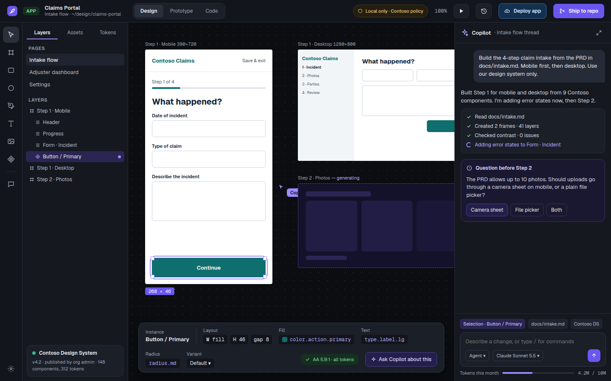
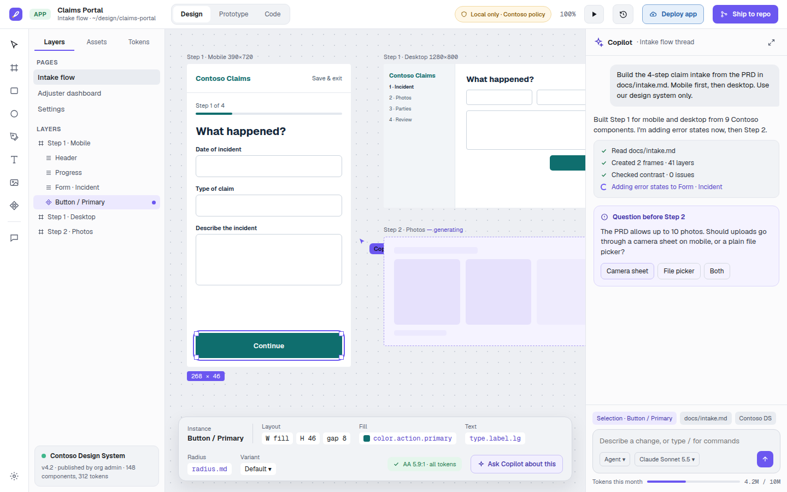

# CADE — Copilot ADE

[](https://github.com/a11smiles/cade/actions/workflows/ci.yml)

CADE is a local, cross-platform design workbench driven by GitHub Copilot. The project aims to support Copilot-assisted design workflows; this repository is a pre-alpha scaffold, not a finished replacement for Figma, Visio, or Spark.

> **Status: pre-alpha scaffold.** The app and crate functionality are partial. See the source-build guidance below and follow development in the [issue backlog](https://github.com/a11smiles/cade/issues).

## Project types and format mappings

The project model defines eight output types. The exporter crate maps them to the formats below; these mappings do not imply that each format has a complete end-to-end exporter.

| Project type | Formats mapped in code |
|---|---|
| App | PNG, SVG, PDF |
| Image | PNG, SVG, PDF |
| Deck | PPTX, PDF, PNG |
| Document | PDF, DOCX, Markdown |
| Motion | MP4, GIF, Lottie, CSS |
| Diagram | VSDX, SVG, PDF, PNG, Mermaid |
| Azure architecture | Bicep, Terraform, SVG, PNG |
| Data model | SQL, SVG, PNG |

## Screenshots

Static previews captured from the `Main` screen in design export `v0001-2026-10-25`; these show the design canvas, not running CADE app behavior.





## What's here

| Path | What |
|---|---|
| `crates/` | 19 Rust crates: document model, CRDT, renderer, Copilot, policy, GitHub, importers, generators |
| `app/src-tauri/` | Tauri 2 desktop shell (`cade-app`) and its IPC commands |
| `app/ui/` | React + TypeScript UI: Start screen, theming and the feedback dialog, so far |
| `design/system/` | CADE's own design tokens (dark and light) and brand book. Source of `tokens.css` |
| `design/exports/` | Versioned UI design exports. Never overwritten; see its README |
| `assets/icons/azure/` | Drop Microsoft's Azure Architecture Icons here (not committed) |
| `docs/` | Architecture overview and decision records |

## Build

```sh
cargo test                        # all crates; no webview needed
pnpm --dir app/ui install
pnpm --dir app/ui build           # regenerates tokens.css, type-checks, bundles
pnpm --dir app/ui test            # UI unit tests (Vitest + Testing Library, jsdom)
pnpm --dir app/ui test:e2e        # UI end-to-end (Playwright, Chromium; mock Tauri IPC)
cargo test -p cade-app            # Tauri IPC commands (needs the platform webview)
cargo run -p cade-app             # desktop app (needs the platform webview)
```

Linux needs `libwebkit2gtk-4.1-dev`, `libayatana-appindicator3-dev`, `librsvg2-dev`, `libsecret-1-dev` and `libfontconfig1-dev`.

## Starting points already in code

| Crate | Working today | Backlog |
|---|---|---|
| `cade-core` | Output kinds, nodes, token-bound values, hex colors | CORE |
| `cade-crdt` | Loro project doc, movable layer tree, snapshot save/open, merge, JSON mirror | CORE |
| `cade-policy` | Full `policy.yml` schema and decisions for models, BYOK, shell, network, MCP, design systems, shipping, telemetry, token budgets | POLICY |
| `cade-copilot` | Copilot and BYOK through the Copilot SDK, a policy-enforcing permission handler, change sets, token meter | COPILOT |
| `cade-github` | Device-flow sign-in, keychain storage, github.com / GHE.com / GHES, issues, duplicate search, PRs | GH, FEED |
| `cade-feedback` | Bug / feature / comment → labeled, redacted issue matching the issue forms | FEED |
| `cade-ddl` | DDL for PostgreSQL, SQL Server, MySQL and Oracle; reversible migrations; PII check | DATA |
| `cade-iac` | Bicep and Terraform (azurerm) for App Service, SQL, Key Vault, Storage; missing-setting check | ARCH |
| `cade-system` | Bindings, impact tracing and deploy order across Data → App → Architecture | SYS |
| `cade-io-visio` | `.vsdx` package reader: pages, masters, macro detection | DIAGRAM |
| `cade-io-pptx`, `-figma`, `-spark` | Package/slide reader, Figma link parsing and endpoints, Spark repo scan | IMPORT |
| `cade-render`, `-text`, `-layout` | Vello scene from nodes, Parley text layout, Taffy auto layout | CANVAS |
| `cade-codegen-react` | Design-system TSX emitter | APP |

## Feedback

Use Help › Send feedback in the app, or the issue forms here (bug, feature request, comment). Either way the issue is filed from your own GitHub account. Set `CADE_FEEDBACK_OWNER` at build time to the GitHub account that owns this repo.

## License

Apache-2.0. CADE is an independent project, not affiliated with GitHub or Microsoft. See [NOTICE](NOTICE).
